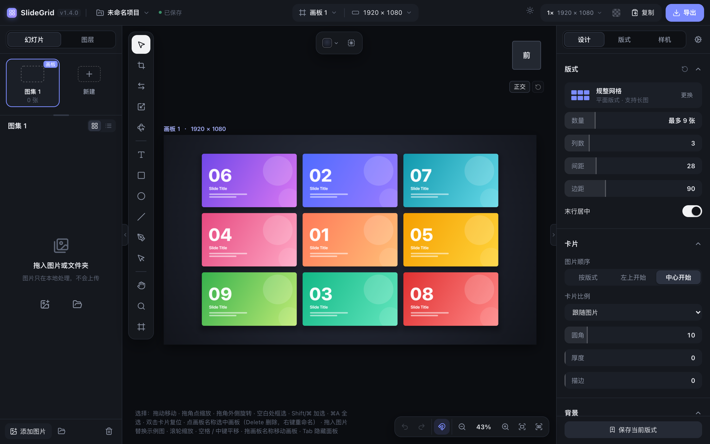
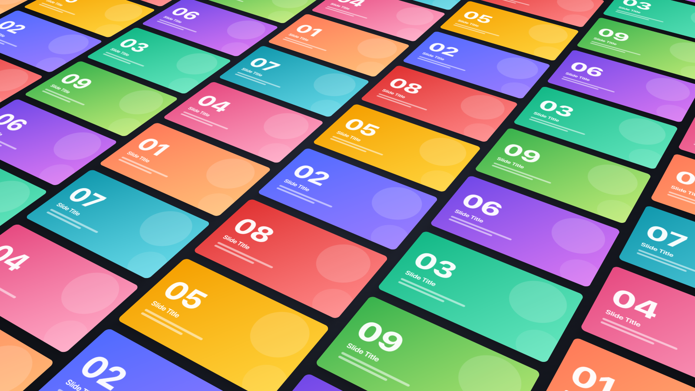
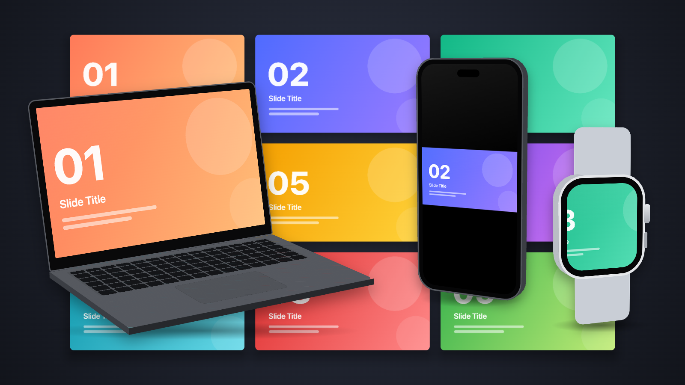
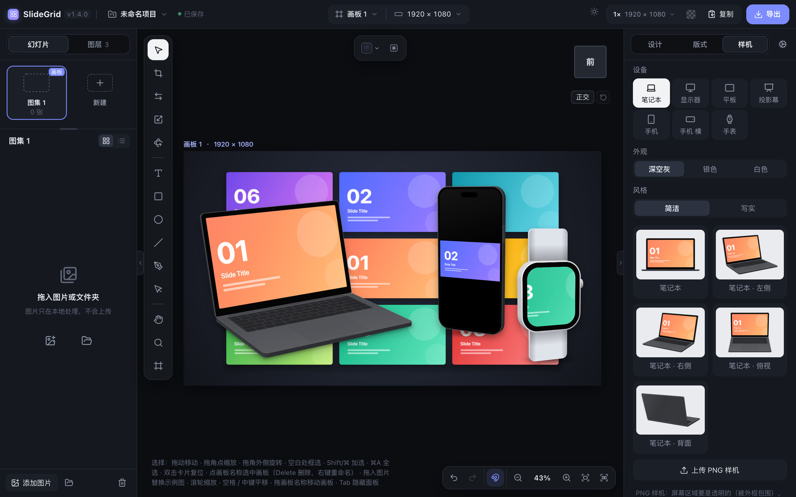

# SlideGrid

把 PPT 导出的幻灯片图片拼成作品展示图。支持平面和 3D 透视版式、设备样机（笔记本 / 显示器 / 平板 / 手机 / 手表 / 投影幕，带角度），
可导出最高 8K 的 PNG / JPG。纯前端实现，没有任何依赖，图片只在本地浏览器里处理。

- **在线使用**：https://wonvy.github.io/SlideGrid/
- **单文件版下载**：https://wonvy.github.io/SlideGrid/SlideGrid.html （另存后双击即可离线使用）



| 3D 版式 | 设备样机 |
|---|---|
|  |  |



## 运行

因为使用了 ES 模块，需要通过本地服务打开（直接双击 `index.html` 会被浏览器拦截）：

- 双击 `start.command`（macOS），或者
- 在项目目录执行 `python3 serve.py`（默认端口 5318），然后打开 http://localhost:5318
  （`serve.py` 会禁止浏览器缓存，更新代码后刷新即可；不要用 `python3 -m http.server`，它可能让浏览器用到旧文件）

### 单文件版（离线双击即可使用）

```
python3 build.py            # 生成 dist/SlideGrid.html 和根目录的 SlideGrid.html
python3 build.py --check    # 检查根目录的 SlideGrid.html 是否和源码一致
```

生成的单文件版（约 1 MB，包含全部代码、样式和图标）不需要服务器，双击用浏览器打开即可，也方便直接发给别人。
输出只由源码决定，源码没变时重新构建得到完全相同的文件。

- **自动更新**：仓库自带提交钩子，启用一次后（`git config core.hooksPath .githooks`），提交 js / css / index.html 的改动时
  会自动重新构建根目录的 `SlideGrid.html` 并一起提交
- 直接双击打开时浏览器不允许读取拖入的**文件夹**（拖入图片文件没问题），请用左栏的「选择文件夹」按钮

- 原理：每个 JS 模块转成 data: URL，用 import map 映射模块路径，源码不需要任何改动
- 项目保存在打开它的浏览器里（与文件所在位置绑定）；换电脑或换浏览器时用「项目 → 导出为 .slidegrid 文件」迁移
- 推荐 Chrome / Edge。如果浏览器不允许本地文件使用存储，仍可编辑和导出图片，但项目不会保存（会有提示）

## 使用

1. 把图片或整个文件夹拖进窗口（也可以用左侧按钮选择），按文件名自然排序。
   左侧图片列表的标题行显示正在看的图集和张数，右边切换网格 / 列表视图；拖动排序，最后一格「添加图片」；
   当前画板里看得见的图片右上角有一个小圆点（没圆点的就是还没用上的）；鼠标悬停在左侧某张上，当前画板里对应的卡片会高亮
2. 单张放入 / 替换：把图片文件拖到任意画板的某张卡片上。
   还没导入图片时，示例卡片就是空位，拖到哪张放进哪张；之后用按钮导入或拖到空白处会先填满剩余空位

### 撤销 / 重做

- ⌘Z / Ctrl+Z 撤销，⇧⌘Z / Ctrl+Y 重做；画布右下角也有按钮，悬停可看到要撤销的是哪一步
- 记录幻灯片增删替换、背景图、各画板的版式 / 参数 / 样式 / 比例 / 构图 / 卡片调整，以及画板的新建、删除、移动、改名
- 切换画板、选择、视图缩放不占用步骤；拖滑块、拖卡片等连续操作合并为一步（松开鼠标算一步结束）
- 最多保留 100 步，切换项目时清空；输入框里的 ⌘Z 仍是输入框自己的撤销

### 多画板

- 一个项目可以有多个画板，排列在工作区里（类似 Illustrator）。每个画板有独立的版式、参数、样式、
  比例、构图、卡片调整和图层。
- **图集**：项目里可以有多个图集（每个是一组有名字的幻灯片），左栏顶部以「叠放」显示（类似 macOS 程序坞的叠放：每个图集的前几张叠成一摞，下面是名称和张数）。
  **点一摞只是查看**（下面的列表显示它的图片，画板不变）；当前画板用的图集带「画板」标记。
  查看别的图集时：把图片**拖到画布的卡片上 = 只替换这一张**（右键「恢复这张卡片原来的图片」可撤回）；
  把图片**拖到上面别的图集上 = 移过去**（按住 Alt 复制）；列表里的排序、删除、导入改的是正在查看的图集；
  提示条里的「用于当前画板」把画板换成这个图集。图集和图片列表之间的分隔条可以上下拖动调整高度（双击恢复）**拖入文件夹（或「选择文件夹」）时，
  每个文件夹自动成为一个图集**（名称就是文件夹名），左栏切到新图集查看（画板不变）；当前图集还空着时，第一个文件夹直接放进去。
  拖入散的图片则加到正在查看的图集。图集右键「用于当前画板」、画板右键「换图集」可以**给画板换图集**（多选画板时一起换）；
  图集右键还能重命名、删除（删除后用它的画板换成别的图集）
- **图片是继承的**：每个画板跟随一个图集——在左栏导入、排序、移除、清空，用这个图集的所有画板一起变。
  在画布上单独改了某个画板的图片（替换某张卡片、右键「从此画板移除」），这个画板就复制一份
  自己的列表，之后图集的变化不再影响它；其他画板不受影响。
  - 左栏显示当前画板用的图片；单独设置过的画板，左栏顶部会提示，并有「恢复跟随」（改回图集）和
    「存回图集」（把这个画板的顺序存回图集）；在这样的画板上用左栏操作，只改这个画板
  - 新建画板跟随当前画板的图集；复制画板时一并复制图集和是否单独设置
  - 旧项目打开时自动转换成一个「图集 1」：顺序和它一致的画板改为跟随，其余的保留自己的列表
- 顶栏中间：「画板 ▾」切换 / 新建 / 复制 / 重命名 / 删除画板；**尺寸按钮**设置当前画板的像素尺寸：宽 × 高输入框（⇄ 横竖互换）、
  常用比例（保持当前短边，如 16:9 → 1920 × 1080）、平台尺寸（1242 × 1660 小红书、900 × 383 公众号封面…）、长图
- **画板尺寸统一用像素**，导出按**倍率**：1×（默认）= 画板的像素，2× / 3× / 4× / 0.5× 或任意倍率，在右上角选择；
  长图 1× 宽 1920。旧项目的比例（16:9 等）打开时换成像素（短边 1080），旧的导出尺寸换成相近的倍率
- **导出多个画板**：鼠标移到「导出」按钮上，面板里勾选要导出的画板（每个显示输出像素，「当前 / 所选 / 全部」快捷勾选），
  多个画板打包成 ZIP，每个按自己的像素 × 倍率
- 点击工作区里的其他画板即切换；右侧面板编辑的始终是当前画板
- **移动画板**：任何工具下拖动画板左上角的名称；画板工具下拖动画板本身（**按住 ⌥ / Alt 拖动 = 复制画板**，原画板不动）；3D 版式下用选择工具拖画板也可以（选择工具在 3D 版式下可以选中、移动图层，但不能单独调整卡片）
  （平面版式里拖空白处是框选卡片）
- **右键菜单**：卡片上（替换图片、用剪贴板图片替换、选中、复位、在列表中定位、移除）、
  画板上（适合窗口、重命名、背景、复制、导出、删除，多选时对所选画板操作）、空白处（新建画板、粘贴、适合全部、全选）
- **粘贴图片**：选中卡片后 ⌘V / Ctrl+V 用剪贴板图片替换它；没有选中卡片时粘贴为新幻灯片
- **多选画板**：在画板外的空白处拖动框选（Shift/⌘ 追加），Shift/⌘ + 单击其他画板加选减选；
  画板工具（⇧O）或 3D 版式下 ⌘A 全选画板；顶栏画板菜单里 Shift/⌘ + 单击同样可以多选
- **复制画板**：⌘D / Ctrl+D（没有选中图层时）复制所选画板，或按住 ⌥ / Alt 拖动画板（按住时指针变成「复制」）
- 选中多个画板后：拖动任一个一起移动；Delete 删除所选；菜单「复制所选」；导出面板里勾选多个画板（ZIP）；
  修改样式（含工具条背景）、比例、版式、版式参数会同时应用到所选画板（参数只同步给同一版式的画板，
  构图和卡片调整不同步），右侧会显示提示条，「只编辑当前」可退出批量编辑

### 工作区导航（参照 Illustrator，只改变视图，不影响导出）

| 操作 | 功能 |
|---|---|
| 滚轮、触控板捏合 | 以鼠标位置为中心缩放视图（「偏好」里可改为滚轮滚动、⌘ + 滚轮缩放） |
| Shift + 滚轮 | 左右平移 |
| 空格按住、中键拖动 | 平移视图 |
| ⌘/Ctrl + 0 · ⌘/Ctrl + ⌥ + 0 | 适合当前画板 · 适合全部画板（双击空白处也可以） |
| ⌘/Ctrl + 1 · ⌘/Ctrl + = / − | 100% · 放大 / 缩小 |

### 工具（左键只执行当前工具）

| 工具 | 快捷键 | 作用 |
|---|---|---|
| 选择 | V | 点选卡片 / 图层，画板内空白处拖动框选，拖动移动，拖四个角等比缩放（⌥ 以中心）；方向键微调，+/- 缩放，双击复位 |
| 裁切 | C | 拖动卡片平移里面的图片，滚轮放大缩小，双击复位；右键可切换「完整显示」（3D 版式也可用） |
| 交换 | X | 把卡片拖到另一张上，只交换这两张卡片的图片（同一张图出现在别的卡片上不受影响，幻灯片列表也不变）；右键「恢复这张卡片原来的图片」/ 画板右键「恢复图片顺序」取消交换 |
| 比例 | S | 拖动以卡片中心等比缩放（Shift 按 5% 吸附） |
| 构图 | O | 调整画板内的构图（会导出）：3D 拖动旋转 / Shift+拖动平移，平面拖动平移，滚轮缩放 |
| 抓手 | H | 平移视图 |
| 放大镜 | Z | 单击放大，⌥ + 单击缩小 |
| 画板 | ⇧O | 点击切换画板，Shift/⌘ 单击加选，空白处框选，拖动移动所选画板，Delete 删除所选 |
| 文字 | T | 单击 = 点状文字（自动宽度，回车换行）；拖动 = 区块文字（按框宽自动换行，拖手柄改框大小、字号不变）；Esc 或点别处结束；选择工具下双击文字再次编辑；属性里「自动换行」可在两者间切换 |
| 矩形 / 椭圆 | M / L | 拖动绘制（Shift 正方形 / 正圆，⌥ 从中心），单击放一个默认大小的 |
| 直线 | \ | 拖动绘制（Shift 按 45° 吸附，⌥ 从中心），单击放一条默认长度的；画好后是两个锚点的路径，可用直接选择调整端点 |
| 钢笔 | P | 参照 Illustrator，见下方「钢笔」 |
| 直接选择 | A | 点锚点显示控制柄，拖锚点 / 控制柄（⌥ 打断对称，Shift 45°），⌥ 单击切换直角 / 平滑，双击路径插入锚点，Delete 删除，方向键微调 |

选择工具下，选中的卡片和图层都可以直接缩放（拖角点）和旋转（拖角点外侧，光标变成旋转图标；Shift 按 15° 吸附）。

工具在工作区左侧竖排；撤销 / 重做、吸附开关和视图缩放在画布右下角；顶栏中间是项目（含保存状态）和画板 / 比例菜单。界面统一为圆角、无描边的深色控件，选中项为白底。
顶部工具条随选择变化（类似 Illustrator 的控制栏），参数用图标和紧凑的数值条；形状的填充、描边，以及对齐 / 分布、排列、布尔运算，在宽度够时整排显示，放不下时依次折叠成按钮（先描边、填充——折叠后按钮上显示当前颜色，点开是同样的控件——再排列、布尔运算，最后才是对齐）：
- 没有选择：画板背景、渐隐遮罩
- 选中文字：字体、字号、字重、对齐（图标）、颜色；选中形状 / 路径：填充类型、填充颜色、**填充不透明度**、描边、整体不透明度；
  排列（上移 / 下移一层、置于顶层 / 底层）；选中两个以上形状时还有布尔运算；另有删除按钮
- 选中卡片：显示方式（填满 / 完整显示）、放大、复位裁切
- 选中卡片或图层时还有对齐 / 分布（卡片和图层可以一起对齐）

选择 / 旋转 / 比例只用于平面版式。Esc 或 ⇧⌘A 取消选择。移动画板：拖画板名称（任何工具），或用画板工具拖动。

### 图片顺序

「设计」页「卡片」里的「图片顺序」决定图片怎么分配到版式的各个位置（每个画板单独设置）：

- **按版式**：从版式的第一个位置开始依次循环
- **左上开始**：先填画板里看得见的卡片（卡片中心在画板内），从左上角开始按行排；画板外的卡片再接着用剩下的
- **中心开始**（默认）：同样先填看得见的卡片，从画板中心向外

主图 + 网格、扇形展开、纵深层叠、环形展台这几种顺序本身有意义的版式不受这个设置影响，始终按左栏的顺序（第一张是主图 / 最前面那张）。

铺满型的 3D 版式（如等距墙）画板外还有很多卡片，「按版式」时画板里容易出现同一张图；后两种方式下，
图片数量够的话画板里不会重复，不够时也只重复必要的次数。调整构图（缩放、平移、3D 角度）后会按新的可见区域重新分配。

### 版式的数量

扇形展开、环形展台、纵深层叠、散落、透视长廊、弧形墙、主图 + 网格、规整网格有「数量」滑块：最多显示几张卡片
（「全部」= 和图片一样多）。图片很多时调小一点，画面不会太挤。默认：规整网格 9 张（3 × 3）、主图 + 网格 7 张（1 + 6）、
散落 12、透视长廊 12、弧形墙 16、扇形 7、环形 12、层叠 6。长图模式不限制数量（要把所有图片排下来）。
铺满型版式（错位铺满、倾斜铺满、倾斜墙面）的卡片铺满整个画板，没有数量，疏密用列数 / 缩放调。
主图 + 网格默认主图在上方。

### 新增版式：悬浮错落、等距展台、空中飘落、满铺堆叠

- **悬浮错落**（3D）：卡片同向侧转、高低交错地浮在画面里（App 界面展示的常见效果），中间的离镜头更近；
  可以排成多行（默认 2 行，最多 5 行，隔行左右错开），可调数量（默认 10）、行数、大小、行距、隔行错开、间隔、高低错落、
  中间前凸、侧转 / 俯仰 / 倾斜、透视强度，整组会自动缩放放进画板
- **空中飘落**（3D）：卡片在空中随机翻转、前后错开，像抛起来的一叠名片；默认整体偏右，左侧留白放标题文字，超出画板的部分裁掉；
  可调数量（默认 7）、大小、大小差异、分布宽度 / 高度、左右偏移、随机位移、平面旋转、空间翻转、前后错开、随机种子、透视强度
- **满铺堆叠**（3D）：大量卡片随机转角、层层叠叠铺满桌面（略带俯视），中间一张主卡片抬起来压在最上面，像一堆撒开的名片；
  卡片铺满画板，图片不够时循环。可调卡片大小、密度、随机旋转、主卡片（开 / 关、大小、角度、抬高）、俯视角度、平面旋转、缩放、随机种子、透视强度
- **等距展台**（3D）：卡片平铺在地面上、俯视桌面（默认带一点透视，透视强度调到 0 就是纯等距视角），离中心最近的几张翻起或浮起，像桌面上摊开的名片 / 网页样机；
  可调列数、间距、错位、翻起数量、翻起角度、浮起高度、翻起的轴、俯视角度、平面旋转、透视强度、缩放
- **分组展台**（3D）：等距展台的有限网格版，**每一列（也可以改成每一行）是一组、用一个图集的图片**，适合分组展示；
  「设计」页的「每组用的图集」里给每列 / 每行选图集（「自动」= 按图集顺序轮流）。可调分组方式（默认每列一组，可改为每行一组）、行数（默认 4）、列数（默认 3）、间距、
  组间距、自动翻起（中间几张）、翻起角度、浮起高度、翻起的轴、俯视角度、平面旋转、透视强度、缩放。
  卡片始终保持图片的比例；俯视越斜画面上越扁，没有透视时容易看成「被拉长」，所以默认俯视 40° 并带透视（远处的卡片变小）
- **单独抬起某张卡片**（等距展台、分组展台）：选择工具点选卡片（Shift / ⌘ 加选），「设计」页的「抬起」里选「抬起 / 放平 / 跟随版式」，
  抬起时再调翻起角度、浮起高度、翻起的轴（下 / 上 / 左 / 右边）和倾斜；也可以右键卡片「抬起这张 / 放平这张」。
  「跟随版式」= 由「翻起数量 / 自动翻起」决定；把自动翻起的某张设成「放平」就不翻了。
  抬起的卡片之间按离镜头远近叠放（近的盖住远的）；带「倾斜」翻起时会自动抬高一点，最低的角刚好贴着桌面，不会插进旁边的卡片
- **远近效果**（等距展台、分组展台、满铺堆叠；其他 3D 版式也有远处渐隐和景深，空中飘落、纵深层叠默认开一点）：
  - **远处渐隐**：远处的卡片淡出到背景（铺满型网格的远端不再突然断掉）；卡片之间有遮挡时不会互相透出来
  - **景深模糊**：离对焦位置越远越模糊（图片内容和边缘都柔化，和导出分辨率无关）；「对焦」默认对在抬起的卡片上
    （没有抬起的卡片时：纵深层叠 / 环形展台对在最前面那张，其他版式对在画面中间那张），也可以手动选远近
  - **桌面投影**：抬起的卡片在桌面上投下影子，抬得越高越淡、越散，往右前方偏一点，从卡片旁边露出来
  - 等距展台默认带一点远处渐隐和景深，默认缩放 1.1（加了透视后近处的卡片不会大得夸张）
- 3D 版式的图层列表里会说明卡片的前后由空间位置决定（不能上移 / 下移）
- 「设计」页的版式参数（和单卡「抬起」设置）里，和默认值不同的参数旁边有一个「恢复默认」按钮，点一下只恢复这一项
- **随机换一个**：有随机种子的版式（散落、空中飘落、满铺堆叠），「设计」页的版式卡片上有一个随机按钮，点一下换一种摆法；
  「随机种子」一行里的「上一个」可以一步步退回之前的摆法
- **版式预览**：在「版式」页把鼠标停在某个版式上，左边会用当前画板的图片显示这个版式的效果，不用点进去

### 立方体视图（3D 版式）

3D 版式时画布右上角有一个立方体，跟着当前视角转动：

- **拖动立方体**：旋转视角（屏幕上左右拖绕竖轴转、上下拖绕横轴转）
- **点面**：正视 / 后视 / 左视 / 右视 / 俯视 / 仰视；**点棱**：45° 视角；**点角**：等轴视角（都有过渡动画）
- 前 / 后 / 左 / 右 / 上 / 下是版式内容本身的方向：等距展台、分组展台、满铺堆叠的桌面是「上」，点「上」就是正对卡片的俯视图（卡片不变形）
- **透视 / 正交**：切换投影方式（正交没有近大远小）；**复位**：回到版式默认的角度
- 视角和投影存在画板的构图里，导出和画布上看到的一样；「设计」页的「构图」里可以一键复位（缩放、平移、角度、投影）

### 卡片裁切

- 卡片里显示图片的哪一部分可以单独调整：裁切工具（C）拖动平移、滚轮放大，或在「设计」页的「裁切」里调放大和位置
- 「完整显示」：卡片收缩到图片比例，不裁切（右键菜单或「卡片裁切」里切换）
- 裁切跟着卡片位置保存，导出时按原图分辨率重新读取，放大后也清晰

### 渐隐遮罩

- 工具条上的遮罩按钮一键套用：单色（整体同一不透明度）、底部 / 顶部 / 左右 / 上下 / 四周 / 对角渐隐
- 让幻灯片层（含投影）逐渐透明、融进背景；背景本身不变。透明背景导出 PNG 时渐隐部分是真正的透明
- 细调在右栏「渐隐遮罩」页：类型（单色 / 线性 / 两端 / 径向）、方向、开始和结束位置、两端的不透明度（单色只有一个不透明度）
- 开启后在「图层」页的「幻灯片」一组里显示为「渐隐遮罩」：点击打开设置，眼睛按钮临时隐藏（设置保留），垃圾桶移除

### 图层（文字、形状、钢笔）

- 每个画板有自己的图层，默认画在幻灯片上面，一起导出；点选时图层优先于卡片
- 「图层」页里幻灯片作为一组列在中间：组里有渐隐遮罩（开启时）和画板里看得见的每张卡片（上面的在前），点击卡片选中它
- 图层上移 / 下移可以越过「幻灯片」：放到下面就画在卡片后面（例如给卡片垫一块底板），右键「移到幻灯片下面 / 上面」一步到位；
  卡片后面的图层只有在没有卡片挡住的地方才点得中
- 平面版式里卡片也能调前后：图层页卡片行的上移 / 下移，右键卡片「上移一层 / 下移一层 / 置于顶层 / 置于底层」，或选中后 ⌘] / ⌘[（加 Shift 置顶 / 置底）；
  上移一层 = 越过上面第一张和它重叠的卡片。3D 版式的前后由空间位置决定，不能调
- 选择工具：拖动移动（吸附到画板、卡片和其他图层），拖选框的角 / 边缩放（Shift 等比、⌥ 以中心），拖角外侧旋转（Shift 按 15°）
- 可以和卡片一起框选、一起移动；⌘D 复制，Delete 删除，⌘] / ⌘[ 上移 / 下移一层（加 Shift 置顶 / 置底），方向键微调
- 字体：可以用电脑上安装的任何字体。字体列表自动检测本机已安装的常用中英文字体（苹方、宋体、微软雅黑、思源黑体、Helvetica…），
  每项用自己的字体预览，可搜索，也可以直接输入字体名；Chrome / Edge 里点「读取本机全部字体」可列出全部字体（浏览器授权一次）。
  本机没装的字体会标「未安装」，显示和导出时用系统默认字体代替
- 「设计」页的「图层属性」（选中图层时）：位置、文字（字体、字号、字重、对齐、行高、字间距、颜色）、填充（纯色 / 线性渐变，
  两端可分别设置不透明度，做透明渐变遮罩）、描边、圆角、不透明度；多选时一起修改
- 「图层」页：点击选中，显示 / 隐藏，锁定（锁定后在画板上点不中），上移 / 下移，双击重命名，删除
- 右键图层：编辑文字 / 锚点、复制、调整层级、锁定、隐藏、删除

### 钢笔（参照 Illustrator）

| 操作 | 作用 |
|---|---|
| 单击 / 按住拖动 | 直角锚点 / 平滑锚点（拉出对称控制柄） |
| Shift | 锚点和控制柄方向按 45° 约束 |
| 拖动时按 ⌥ | 打断：只调离开的一侧控制柄（转角） |
| 拖动时按住空格 | 移动正在放置的锚点 |
| 点最后一个锚点 | 去掉它离开的控制柄（下一段从直角开始）；按住拖动 = 单独拉出新的控制柄 |
| 点第一个锚点 | 闭合路径（按住拖动调整起点的控制柄） |
| 按住 ⌘ / Ctrl | 临时切到直接选择，拖锚点 / 控制柄 |
| Enter / Esc / Backspace | 结束 / 结束 / 删除上一个锚点 |
| 对选中的路径（没在画时） | 点线段添加锚点，点锚点删除锚点，点开放路径的端点从那里继续画 |

光标旁会提示当前点击的效果（闭合路径、转为直角、添加 / 删除锚点、继续绘制）。

### 设备样机

- 右栏「样机」页（图层下方）：先选设备（**笔记本 / 显示器 / 平板 / 投影幕 / 手机（竖、横）/ 手表**），再选外观（深空灰 / 银色 / 白色），
  点这种设备的某个角度，样机图层加到当前画板中间，屏幕里显示画板的幻灯片；连续添加时依次显示下一张、稍微错开。
  竖屏手机、手表这类屏幕比例和幻灯片差很多的设备，默认「完整显示」
- 样机卡片也可以**拖到画板上**：放在松手的位置，落在哪个画板就加到哪个画板（会切换过去），本项目的 PNG 样机同样可以拖
- 每种设备都有正面和**带角度**的预设（左侧 / 右侧 / 俯视）。带角度的设备用 3D 平面搭成（笔记本的屏幕盖 + 同宽的键盘面、
  显示器的面板 + 支架底座、手机 / 平板 / 手表的机身侧边、投影幕的三脚架），透视投影后贴图，任何尺寸都清晰；
  选中后可以用「左右角度」「俯视角度」继续调整
- 样机是图层：可以移动、等比缩放、旋转、调整层级，和文字、形状一起导出；设备全部矢量绘制，导出时按输出尺寸读取原图
- 选中样机后，在「设计」页或顶部工具条更换设备（保持中心和宽度）、左右 / 俯视角度、显示第几张、填满屏幕 / 完整显示、
  **画面放大和水平 / 垂直位置**（屏幕里显示幻灯片的哪一部分）、外观、投影、**倒影**
- 放在桌面上的设备（笔记本、显示器、投影幕）和带角度的设备，开启投影时底部还有一圈接触阴影
- **更换屏幕内容**：把图片文件拖到样机上（或选中样机后 ⌘V 粘贴、在「设计」页点「更换屏幕图片…」），屏幕改用这张图片
  （样机自己的素材，不加入幻灯片列表）；把左栏的幻灯片拖到样机上，屏幕改为显示那一张；「用幻灯片」改回显示幻灯片
- **上传 PNG 样机**：「样机」页点「上传 PNG 样机」，弹窗里显示 PNG 和一个半透明的四边形，拖动四个角对准屏幕的四个角
  （可以是倾斜的透视屏幕；拖角点时有放大镜，方向键按像素微调，可预览填充效果），图片按透视填充进去。
  初始位置来自自动识别（被外框包围的透明区域）；屏幕区域不透明的 PNG，图片画在外框上面，否则画在 PNG 下面（带投影）。
  选中 PNG 样机后，「设计」页的「调整屏幕区域…」可以重新对准。本项目用过的 PNG 样机列在下方，点击可再次添加

### 粘贴图片和 SVG、布尔运算

- ⌘V 粘贴图片：选中卡片时替换它的图片；否则作为**图片图层**放到当前画板（可移动、等比缩放、旋转、圆角，导出时读取原图）
- ⌘V 粘贴 SVG（从 Illustrator / Figma 复制的矢量，或 .svg 文件）：转成**可编辑的路径图层**，保留复合路径的镂空、
  填充 / 描边 / 渐变 / 不透明度，文字转成文字图层；太大自动缩小、太小（图标）自动放大，放在画板中间
- 从 PowerPoint / Office 复制的图形：剪贴板里同时有 PNG 和 `image/svg+xml`，粘贴时优先用 SVG（转成可编辑图层）。
  浏览器的 paste 事件只带 PNG，SVG 要通过剪贴板接口读取，第一次可能请求授权；拒绝或没有 SVG 时按图片粘贴。
  选中卡片时粘贴仍是替换卡片的图片
- 右键菜单「粘贴为图层」也可以（浏览器可能请求读取剪贴板的授权）
- 布尔运算：选中两个以上形状（矩形、椭圆、路径），在顶部工具条或右键菜单选择**合并 / 减去顶层 / 相交 / 排除重叠**，
  结果是一个路径（曲线会细分成折线）；减去顶层保留最下面形状的样式，其他保留最上面形状的样式
- 图层可以超出画板：画板外的部分在工作区里照常显示、可以点选，导出时按画板裁切

### 卡片多选、吸附与对齐

- **多选卡片**：在画板内空白处拖动框选；Shift / ⌘ + 单击加选减选；Shift / ⌘ + 从卡片上拖动追加框选
  （铺满型版式没有空白时用）；⌘A 全选当前画板的卡片。点其他画板上的卡片会直接切换过去并选中它。选中的卡片一起移动、旋转、缩放，
  方向键与 +/− 同样作用于所有选中的卡片（缩放手柄只在单选时显示）
- **吸附**：拖动卡片时吸附到其他卡片和画板的边缘 / 中线，拖动画板时吸附到其他画板，并显示粉色参考线；
  拖动时按住 ⌘ / Ctrl 临时关闭，工具条上的磁铁按钮可一直开关
- **对齐 / 分布**：选中卡片后工具条出现对齐按钮——多选时在选中卡片之间对齐，单选时对齐到画板；
  选中 3 张以上可水平 / 垂直等距分布。对齐基于屏幕上看到的位置，倾斜的版式也适用

### 样式与导出

- 所有参数都可以用滚轮调整（Shift 加速，双击名称恢复默认）：鼠标移到参数上停留片刻，出现左侧高亮条后再滚动；
  滚动页面会自动取消激活，避免误改。右侧「偏好」里可改为「按住 ⌥ / Alt 时」或「关闭」
- 顶部工具条上的参数（字号、不透明度、填充、裁切放大…）和视图缩放百分比：鼠标放上去直接滚动即可，不需要停留（工具条不会滚动，不会误触）
- **按住参数名称上下拖动**调整数值（类似 Photoshop，向上 / 向右增大）：数值条拖约 240 像素走完整个范围（Shift 精调），
  数字输入条每像素一步（Shift ×10）；右栏和顶部工具条都可以，一次拖动是一步撤销
- 画板背景：点工具条上的背景色块，弹出一个色块网格（透明、纯色、渐变），底部一行是自定义颜色、
  背景图片、幻灯片模糊和「更多背景设置」（跳到右侧完整设置）。只改当前画板
- 背景（样式 → 背景）：透明（工作区显示棋盘格，导出 PNG 保留透明）、纯色、线性 / 径向渐变、
  背景图（铺满 / 完整显示 / 平铺，可模糊、加遮罩；点击选择或把图片拖到「背景图」上）、幻灯片模糊；都可以再加暗角
- 导出：顶栏右侧选尺寸（菜单里显示当前画板实际输出的像素，可自定义，滚轮切换）→「复制」（当前画板 PNG）或「导出」。
  鼠标悬停在「导出」上可设置范围（当前画板 / 全部画板 ZIP）、格式、JPG 质量、透明背景、文件名
- 透明背景：复制按钮左边的棋盘格开关只管「复制」，导出面板里的「透明背景」只管导出，两者互不影响；
  打开时去掉画板背景（幻灯片、投影、图层照常），画板背景本身设为透明时两者都是透明的
- 右侧面板：左边竖排的图标栏切换三页，每页顶部是页面标题；参数一律一行一个——
  数值是「数值条」（名称在左、数值在右，左右拖动整条调整，方向键微调），选项少的用分段按钮，
  颜色是色块加可输入的色值，成对的参数（X / Y、宽 / 高、起始 / 结束色）并排；分组标题 14px，箭头在右侧可折叠
- 右侧面板按图标栏分页（从上到下）：
  - 「版式」只用来选版式（内置 / 我的版式；单击应用，双击应用并切到设计页）
  - 「设计」跟随选择（类似 Figma）：选中图层时是图层属性，选中卡片时是裁切和位置 / 旋转 / 缩放；
    什么都没选时是当前版式（「更换」去版式页）、版式参数、卡片样式（图片顺序、圆角、描边）；用构图工具调整过构图时，下面会出现「构图」一栏（显示调整了什么，可一键复位）。点「画板设置」或 Esc 回到这里
  - 「背景」「投影」「渐隐遮罩」：画板样式各自一页，与选择无关，随时可调
  - 「图层」：新建文字 / 形状 / 路径，当前画板的图层列表
  - 「偏好」（图标栏底部）：滚轮的操作方式
  - 各区块可整行点击折叠；界面文字不小于 12px
- 左右两栏边缘可拖动调整宽度，双击恢复；窗口变窄时两栏自动收窄，给工作区留出空间；**Tab 隐藏 / 显示左右两栏，Shift+Tab 只切换右栏**（类似 Photoshop），
  也可以点栏顶的收起按钮，收起后点屏幕边缘的小按钮展开
- 浏览器自带的页面缩放（Ctrl/⌘ + 滚轮、⌘ +/−/0、捏合）已禁用，缩放只作用于工作区视图

### 我的版式

- 「设计」页底部的「保存当前版式」（显示画板设置时出现，保存后在「版式」→「我的版式」里）：保存基础版式、参数、逐张卡片的移动 / 旋转和视图，
  可选同时保存样式（背景、圆角、投影，不含背景图本身）和画布比例；自动生成缩略图
- 点击卡片即可套用到任何项目；悬停可覆盖更新、重命名、导出、删除
- 版式可以导出为 `.json` 文件分享，导入时用面板上的按钮或直接拖进窗口
- 格式带版本号（见 `js/persist/presets.js`），缺省字段套用时使用默认值，方便以后扩展

右侧面板的每个区块、样式里的「背景 / 幻灯片 / 投影」分组都可以点击标题折叠，状态会记住。

### 项目

- 点顶栏的项目名打开「项目」面板：新建、打开、重命名、复制、删除、导入、导出
- 每个项目独立保存图片、版式、样式和视图，修改后自动保存（⌘S 立即保存）
- 「导出」生成 `.slidegrid` 文件（标准 zip：project.json + 原图），可以备份或发给别人；
  导入时可以用面板里的按钮，或直接把 `.slidegrid` 文件拖进窗口
- 数据保存在当前浏览器、当前网址下（IndexedDB）：换浏览器或换地址（比如 localhost 和外网地址）互不共享，
  需要迁移时用导出 / 导入

## 目录结构

```
index.html
SlideGrid.html         单文件版（build.py 生成，提交钩子自动更新）
build.py               打包成单个 HTML（输出到 dist/ 和根目录）
tests/smoke.py         冒烟测试（Playwright，开发版 + 单文件版）
tests/visual.py        版式截图对比（每个版式和 tests/baseline/ 里的基准图比较）
tests/screenshots.py   生成 README 截图（docs/images/）
.github/workflows/     推送后自动测试、构建、发布到 GitHub Pages
.githooks/pre-commit   提交前自动重新构建单文件版
serve.py               本地开发服务器（禁止缓存）
css/style.css
js/
  main.js              入口：创建各模块并把它们连起来
  app/                 应用层（由 main.js 组装）
    workspace.js       工作区渲染循环、视图、屏幕坐标 ↔ 画板 / 卡片
    boards.js          画板 → 渲染输入、示例占位图
    uiState.js         悬停 / 选中等交互状态（不保存、不进撤销）
    importing.js       导入图片：选择、拖入、粘贴、背景图
    exporting.js       导出、复制到剪贴板、离屏预览与缩略图
    boardOps.js        画板新建 / 复制 / 重命名 / 删除
    alignment.js       卡片对齐、分布、吸附参考线
    contextMenus.js    工作区右键菜单
    layerTools.js      图层交互：绘制、选择变换、文字编辑、布尔运算
    pathTools.js       钢笔与直接选择（参照 Illustrator 的快捷键）
    mockups.js         设备样机：样机页、拖到画板上、上传 PNG 样机、调整屏幕区域
    memory.js          大项目的内存估算和保护（提示、减少撤销步数）
  state.js             全局状态与操作（设置会存到 localStorage）
  config.js            画布比例等常量
  core/                store、工具函数
  layouts/             版式（每个版式一个文件）
    index.js           版式注册表 + 接口说明
    helpers.js         网格、铺满等通用算法
    flat/  3d/
  workspace/view.js    工作区视图（多画板的缩放 / 平移 / 适合窗口）
  workspace/snap.js    吸附、对齐、分布的几何计算
  render/              WebGL2 渲染
    scene.js           版式结果 → 可绘制场景（预览与导出共用，按输入缓存）
    renderer.js        绘制：圆角/描边/投影/渐隐遮罩都在着色器里计算；画面外的卡片不画
  layers/              图层：model.js 数据与几何（子路径、锚点、贝塞尔、变换），draw.js 绘制（工作区与导出共用），
                       schema.js 属性面板，fonts.js 本机字体，svgImport.js SVG → 图层，boolean.js 布尔运算，devices.js 设备样机，warp.js 透视填充
  vendor/              内置的第三方代码（polygon-clipping）
    shaders.js  math.js  background.js
    picking.js         预览区点选（悬停、拖放定位）
  slides/              图片导入、解码、示例占位图
  project/controller.js  当前项目的加载、自动保存、切换与管理
  project/history.js   撤销 / 重做（保存状态引用的快照，连续操作合并）
  persist/             IndexedDB 存储、项目文件（.slidegrid）、我的版式、极简 ZIP 读写
  export/              高清导出（按需读取原图分辨率 + 分块渲染）、剪贴板
  style/schema.js      样式参数定义
  ui/                  面板、控件（由 schema 自动生成）
```

## 性能

- 场景按输入（幻灯片、版式、参数、样式、比例、构图、卡片调整）缓存：只有改动过的画板重新排版，
  悬停、选中、平移、缩放视图都不重建场景
- 视野外的画板不画；画板里的卡片按包围盒裁剪，放大查看或分块导出时只画可见的部分
- 画板背景缓存成小图；导出面板的预览合并连续修改，并复用同一个离屏渲染器
- 调试：控制台 `SlideGrid.perf.avg` 查看最近 120 帧的平均渲染耗时（毫秒），`SlideGrid.memory.estimate()` 查看图片占用的内存估算
- 大项目：图片估算占用超过约 1.5 GB（约 110 张 1600 px 的幻灯片）时提示一次，并把撤销步数从 100 减到 25
  （撤销记录会一直引用已删除的图片）；样机贴图全局最多缓存 64 张

## 测试

```
pip install -r tests/requirements.txt
python -m playwright install chromium
python tests/smoke.py          # 开发版（本地服务）+ 单文件版（file:// 直接打开）
python tests/visual.py         # 版式截图对比
python tests/visual.py --update  # 版式的画面是有意改的：更新基准图（提交 tests/baseline/）
python tests/screenshots.py    # 重新生成 README 截图
```

版式截图对比：每个版式用默认参数和同一组测试图片渲染一张小图，缩小到 160 像素宽后和 `tests/baseline/` 里的基准图比较
（允许抗锯齿之类的细微差别）。卡片少了、比例或位置变了、被裁掉都会报出来，这次的截图和差异图（红色是不同的地方）在 `tests/visual-out/`。
新增版式后运行一次 `--update` 生成它的基准图。

冒烟测试走一遍：打开页面、选择 / 拖入图片、图片继承（共用 / 单独设置）、添加带角度的样机、撤销 / 重做、导出、刷新后数据还在。
推送到 GitHub 后会自动运行（`.github/workflows/pages.yml`），通过后构建单文件版并发布到 GitHub Pages。

## 发布（GitHub Pages）

第一次需要在仓库 **Settings → Pages → Build and deployment → Source** 选择 **GitHub Actions**。
之后每次推送到 main，测试通过就自动发布：在线版 https://wonvy.github.io/SlideGrid/ ，单文件版 https://wonvy.github.io/SlideGrid/SlideGrid.html

## 新增一个版式

1. 在 `js/layouts/flat/` 或 `js/layouts/3d/` 新建文件，导出一个对象：
   `id`、`name`、`category`、`icon`、`params`（参数 schema）、`compute()`
2. 在 `js/layouts/index.js` 的数组里加上它

`compute({ n, aspect, W, H, p })` 返回每张图的位置、尺寸和旋转，右侧参数面板会根据 `params` 自动生成。
接口细节见 `js/layouts/index.js` 顶部的注释。

## 后续计划

- 图片图层（Logo、二维码）
- 图层的投影、布尔运算
- 拖动时显示间距数值、多画板导出 PDF
- Safari / Firefox 兼容性检查

## 第三方

- 图标：[Lucide](https://lucide.dev)（ISC 许可），内嵌在 `js/ui/icons.js`，许可证见 `licenses/lucide-LICENSE.txt`
- 布尔运算：[polygon-clipping](https://github.com/mfogel/polygon-clipping) 0.15.7（MIT），内置在 `js/vendor/polygonClipping.js`，
  许可证见 `licenses/polygon-clipping-LICENSE.md`
